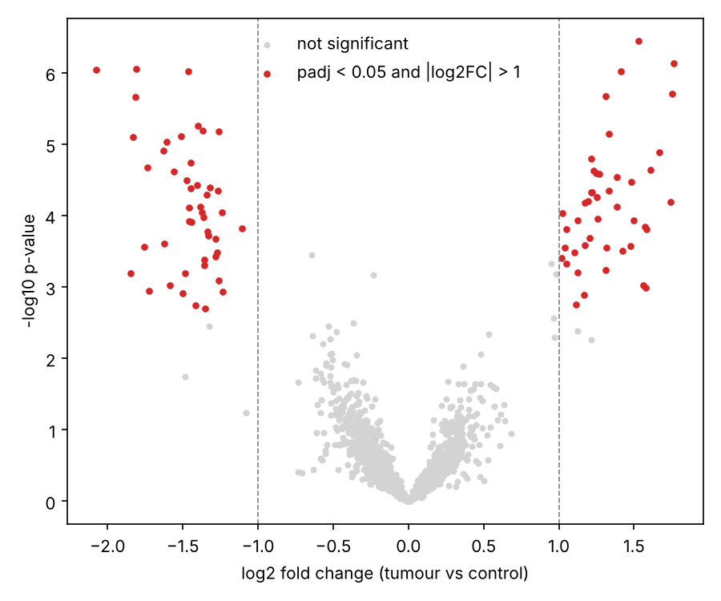

# Differential Gene Expression: a Minimal Pipeline

A small notebook showing the core logic of a differential expression analysis:

1. simulate a count matrix (negative binomial, 2,000 genes, 6 vs. 6 samples)
2. normalise (CPM, log2)
3. PCA quality check
4. per-gene Welch t-test with Benjamini-Hochberg correction
5. volcano plot and heatmap
6. compare the result with the known simulated truth

The data are simulated so the notebook is self-contained and the result can be validated.
The last section explains how to swap in a real dataset from NCBI GEO.



## Run it

```bash
pip install numpy pandas scipy statsmodels matplotlib jupyter
jupyter notebook differential_expression.ipynb
```

## Skills shown

pandas, NumPy, SciPy, statistical testing and multiple-testing correction, data visualisation.
Note: real RNA-seq analyses normally use dedicated tools (DESeq2, edgeR, limma).
